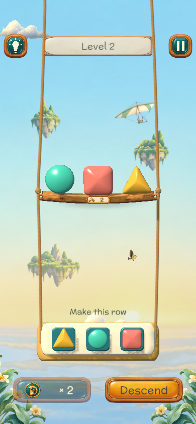
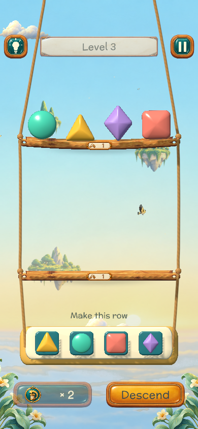
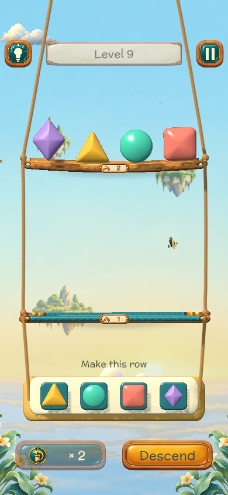
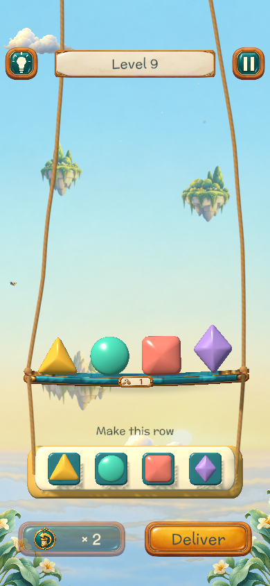
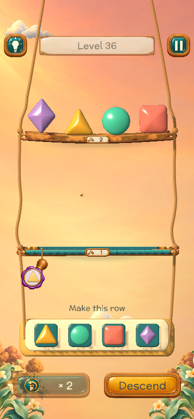
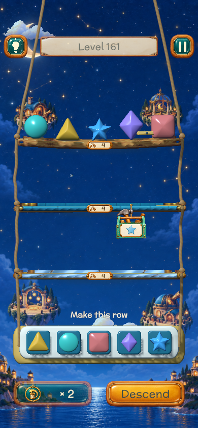
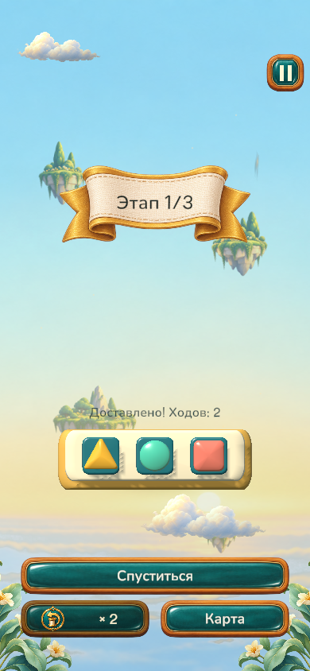
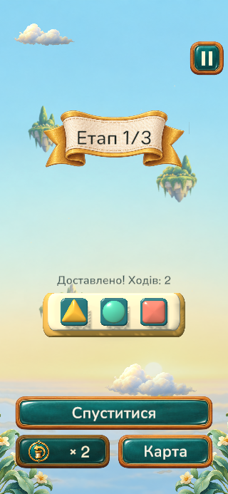

# Campaign logic — 8 October 2026

Fresh starts now load the authored puzzle without the repeated three-stage wrapper or automatic director variation. Legacy recipes and their exact attempts still resume unchanged.

- Completed all **2,157** solver searches and exact witness replays: 540 campaign puzzles and 1,617 localized bindings. Every command was accepted, preserved the multiset, and reached the exact receiver (`authored-proofs.csv`).
- The audit test finished its assertions and wrote the full CSV, but NUnit reported its default 180-second timeout (run lasted 733 seconds). This is recorded in `editmode.xml`; it is not a clean test-suite pass. Raised the audit timeout and reused primary witnesses for subsequent localized replays; this test-only optimization was not rerun.
- **23** remaining selected EditMode tests passed. **5** focused PlayMode tests passed: actual authored floor transitions, same-puzzle retry, tutorial opt-out, deferred lesson retirement, successful guided swap, and popup cleanup (the floor and retry cases share one test).
- Nine native Unity portrait captures cover authored early/combined/night puzzles, the real roller landing, and EN/RU/UK legacy ribbons. The UK checkpoint uses large text at 320×693. These are Editor renders, not physical-device screenshots.
- Source IDs, hashes, resolver rules, store IDs, prices and save schema were preserved. Existing phone save was read for diagnosis only; it was not overwritten by QA.

## Images

The iPhone Release build was installed and launch/relaunch accepted. See `../iOS-2026-10-08-campaign/README.md` for device verification limits.
